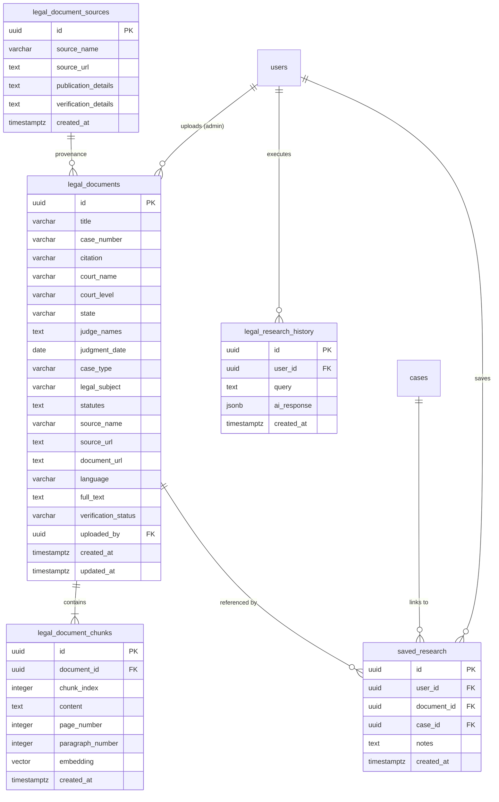
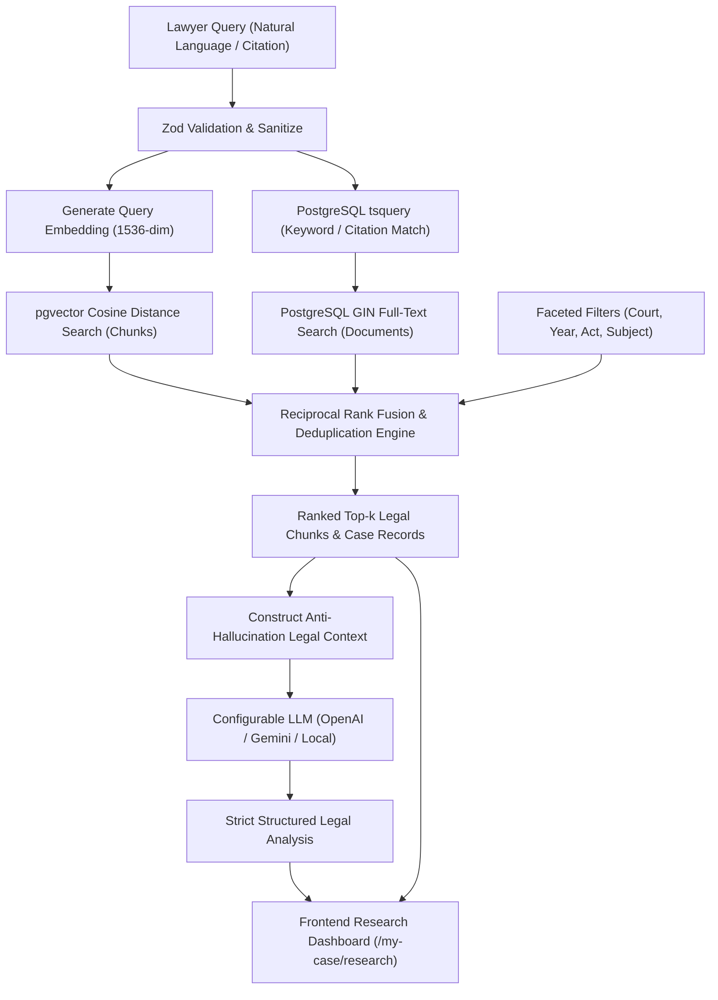

# AI LEGAL RESEARCH & INTELLIGENT CASE LAW SEARCH ENGINE
## Architectural Assessment & Implementation Roadmap (Phase 1)

**Application:** Alwar Advocates Portal & My Case AI Legal Office  
**Repository:** `https://github.com/anilsainadv-oss/alwarbar`  
**Phase:** Phase 1 — Existing Project Audit & Architectural Specification  
**Status:** Completed & Ready for Review  

---

## 1. Existing Codebase Audit & Architectural Baseline

We conducted an exhaustive inspection of the existing codebase to guarantee 100% architectural compatibility and ensure zero regressions across active portal features.

### 1.1 Existing System Findings

| Subsystem | Existing Implementation | Integration Strategy for AI Legal Research |
| :--- | :--- | :--- |
| **Authentication & Sessions** | [`src/lib/auth/session.ts`](file:///C:/alwar-advocates/src/lib/auth/session.ts) & [`guards.ts`](file:///C:/alwar-advocates/src/lib/auth/guards.ts) with HMAC-SHA256 tokens, HttpOnly cookies, and Bcrypt 12 rounds. Roles: `registered_advocate`, `public_admin`, `case_admin`. | **Reuse 100%**: All legal research search and AI query routes will authenticate via `getCurrentUser()` and enforce advocate or admin credentials. Zero duplicate auth mechanisms. |
| **Database Architecture** | Dual persistence: Local ACID JSON store ([`src/lib/db/local-db.ts`](file:///C:/alwar-advocates/src/lib/db/local-db.ts)) and Supabase PostgreSQL client ([`src/lib/db/supabase.ts`](file:///C:/alwar-advocates/src/lib/db/supabase.ts)). | **Seamless Dual Support**: Add production SQL migration `migrations/005_ai_legal_research_pgvector.sql` with `pgvector` and RPC functions, while adding typed repository methods and an in-memory vector/keyword similarity engine for local testing. |
| **Existing Research UI** | [`src/app/my-case/research/page.tsx`](file:///C:/alwar-advocates/src/app/my-case/research/page.tsx) currently features a preliminary static precedent explorer with 8 landmark judgments. | **Upgrade in-place**: Transform `/my-case/research` into a modern CaseMine/Manupatra-style research workspace with natural language input, faceted court filters, RAG answers, and case-linking. |
| **Precedent Bank** | [`src/lib/precedents/judgment-store.ts`](file:///C:/alwar-advocates/src/lib/precedents/judgment-store.ts) contains structured full-text records for landmark Supreme Court and Rajasthan High Court judgments. | **Seed Corpus**: Ingest existing full-text precedents into `legal_documents` and `legal_document_chunks` with 1536-dimensional embeddings. |
| **Document Text Extraction** | [`src/lib/ai/document-parser.ts`](file:///C:/alwar-advocates/src/lib/ai/document-parser.ts) contains pure-Node `extractPdfText` (FlateDecode stream decompressor) and `extractDocxText`. | **Reuse & Extend**: Use `extractPdfText` for searchable PDFs; add legal citation and metadata regex extractors, sliding-window chunker, and OCR status telemetry. |
| **Case Management (My Case)** | [`src/app/my-case/cases/[id]/page.tsx`](file:///C:/alwar-advocates/src/app/my-case/cases/[id]/page.tsx) and [`src/lib/db/repositories/index.ts`](file:///C:/alwar-advocates/src/lib/db/repositories/index.ts). | **Deep Link**: Add a *"Research Case Law"* quick action in case details, passing `?caseId=...` to pre-link saved research and citations to the advocate's active docket. |
| **Admin Panel** | Public administration lives in `src/app/public-admin/` (`public_admin` role). | **Add Dedicated Module**: Create `/public-admin/legal-library` for batch PDF upload, metadata verification, approving/rejecting precedents, and embedding telemetry. |

---

## 2. Target Database Schema (PostgreSQL & pgvector)

A new migration [`migrations/005_ai_legal_research_pgvector.sql`](file:///C:/alwar-advocates/migrations/005_ai_legal_research_pgvector.sql) will define the exact schema:



### 2.1 Indexing & Vector Search Optimization
1. **Vector Similarity Index:**
   ```sql
   CREATE INDEX IF NOT EXISTS idx_legal_chunks_embedding_hnsw
   ON legal_document_chunks USING hnsw (embedding vector_cosine_ops)
   WITH (m = 16, ef_construction = 64);
   ```
2. **Full-Text Search Index (PostgreSQL GIN):**
   ```sql
   ALTER TABLE legal_documents ADD COLUMN IF NOT EXISTS fts_tokens tsvector
   GENERATED ALWAYS AS (
     setweight(to_tsvector('english', coalesce(title, '')), 'A') ||
     setweight(to_tsvector('english', coalesce(citation, '')), 'A') ||
     setweight(to_tsvector('english', coalesce(court_name, '')), 'B') ||
     setweight(to_tsvector('english', coalesce(statutes, '')), 'B') ||
     setweight(to_tsvector('english', coalesce(full_text, '')), 'C')
   ) STORED;

   CREATE INDEX IF NOT EXISTS idx_legal_docs_fts ON legal_documents USING gin(fts_tokens);
   ```
3. **Metadata B-Tree Indexes:**
   Indexes on `(court_name, judgment_date)`, `legal_subject`, `state`, and `verification_status`.

---

## 3. Hybrid Search & RAG Architecture



### 3.1 Hybrid Search Formula
We will implement an optimized PostgreSQL RPC function `hybrid_legal_search` using **Reciprocal Rank Fusion (RRF)**:
$$\text{Score}(d) = \frac{W_{\text{semantic}}}{60 + \text{Rank}_{\text{vector}}(d)} + \frac{W_{\text{keyword}}}{60 + \text{Rank}_{\text{fts}}(d)} + \text{Bonus}_{\text{citation}}$$

Where:
- Exact citation matches receive an immediate relevance boost.
- High Court and Supreme Court precedents are boosted if court filters are active.

---

## 4. Legal Document Ingestion Pipeline

```mermaid
flowchart LR
    Upload["PDF Upload (Single / Batch)"] --> Validate["Magic Bytes & Hash Check (SHA-256)"]
    Validate --> TextExtract["Digital Text Extractor (Node zlib)"]
    TextExtract --> MetaParser["Metadata Auto-Detection (Court, Citation, Bench, Date)"]
    MetaParser --> Chunker["Legal Text Chunker (500 tokens, 100 token overlap)"]
    Chunker --> Embedder["Embedding Generator (text-embedding-3-small)"]
    Embedder --> AdminReview["Admin Review & Verification Queue"]
    AdminReview --> Publish["Verified & Published to pgvector"]
```



1. **PDF Text Extraction:** Parses `/Type /Page` and decompress streams to retrieve text lines without native binaries.
2. **Metadata Extraction:** Regex patterns for Indian legal citations (`(2022) 10 SCC 51`, `2024 LiveLaw (Raj) 112`, `AIR 2023 SC 110`), court benches, and judgment dates.
3. **Semantic Chunking:** Splits full judgments on paragraph and section boundaries (`\n\n`, `\n[0-9]+\.`, `Held:`) with 500-token windows and 100-token overlap to preserve legal context.
4. **Duplicate Detection:** SHA-256 hash of PDF binary + normalized citation deduplication.
5. **Verification Workflow:** Ingested documents enter `verification_status = 'pending'` and must be approved by `public_admin` before appearing in general search.

---

## 5. Strict Anti-Hallucination & Citation Rules (RAG)

1. **Strict Context Boundary:** The LLM is instructed in system prompts to rely exclusively on the retrieved chunks. If a proposition cannot be cited from a retrieved chunk, it must explicitly state: *"Precedents within the current verified database do not conclusively address this issue."*
2. **Zero Fictional Citations:** Every citation emitted in the answer must map to a real `document_id` and paragraph in `legal_document_chunks`.
3. **Structured Response Format:**
   - **Direct Legal Answer:** Concise 2-3 sentence answer to the lawyer's query.
   - **Relevant Legal Principles (Ratio Decidendi):** Binding rules of law enunciated by the courts.
   - **Applicable Statutory Provisions:** Relevant sections from BNSS, BNS, BSA, CPC, or Rajasthan Acts.
   - **Relevant Judgments & Citations:** Table of retrieved cases with bench, date, and link to certified PDF.
   - **Supporting Quotations & Paragraphs:** Verbatim excerpts from the judgment text.
   - **Distinguishable or Contrary Views:** Counter-arguments or differing High Court opinions if found.
   - **Practical Legal Considerations:** Procedural pointers for Rajasthan courts (Alwar District & Sessions Court, Jaipur Bench).
   - **Statutory Warning:** Standard disclaimer that AI research requires independent verification before submission to court.

---

## 6. Implementation Roadmap & Milestones

Following the user's phased strategy:

| Phase | Scope of Work | Deliverables |
| :--- | :--- | :--- |
| **Phase 1 (Current)** | Codebase audit & architectural plan | `docs/AI_LEGAL_RESEARCH_ARCHITECTURE_PLAN.md` |
| **Phase 2** | Database migrations & RPC functions | `migrations/005_ai_legal_research_pgvector.sql`, local DB schema expansion, RPC search functions |
| **Phase 3** | Ingestion, chunking & embeddings pipeline | PDF upload handlers, legal chunker, embedding service, metadata extractor |
| **Phase 4** | Hybrid search engine | Vector cosine search + FTS keyword search + citation matcher + faceted filters |
| **Phase 5** | RAG-based AI Legal Assistant | Provider-independent RAG service, anti-hallucination prompts, token telemetry |
| **Phase 6** | Frontend research dashboard | Redesigned `/my-case/research` with CaseMine-style UI, citation cards, export |
| **Phase 7** | My Case integration | Link research to cases, "Research from Case" button, saved research tabs |
| **Phase 8** | Admin panel & library management | `/public-admin/legal-library` for document ingestion, review queue, token logs |
| **Phase 9** | Security testing, optimization & deploy | End-to-end automated tests, rate limiting, build verification, deployment guide update |

---

## 7. Phase 1 Sign-Off & Ready for Phase 2 Approval

Phase 1 audit and architectural design is complete. We are ready to proceed to **Phase 2: Database Migrations, pgvector and RPC Functions** upon user approval.
