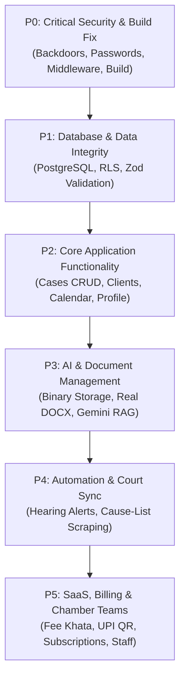

# REMEDIATION ROADMAP — ALWAR ADVOCATES PORTAL
**Platform:** Alwar Advocates Portal & My Case AI Legal Office  
**Repository:** https://github.com/anilsainadv-oss/alwarbar  
**Active Branch:** `audit-remediation`  
**Execution Strategy:** Strict Phased Remediation (P0 through P5)  
**Rule Compliance:** No source code modifications until user approval.

---

## ROADMAP OVERVIEW

This remediation roadmap addresses the empirical vulnerabilities, missing functionality, and architectural gaps uncovered during the comprehensive audit. Every phase is scoped with clear deliverables, exact target files, verification commands, and non-breaking backward compatibility.



---

## PHASE P0: CRITICAL SECURITY & BUILD REMEDIATION
**Goal:** Eliminate universal backdoor login, patch password hashing, enforce edge session security, and restore production build capability.

### Work Items
1. **Fix Production Build Compilation Failure:**
   - **Target File:** `src/app/api/public/judgments/download/route.ts` (Line 67)
   - **Remediation:** Cast binary `pdfBuffer` to `new Uint8Array(pdfBuffer)` or `new Response(pdfBuffer as unknown as BodyInit)` to satisfy Next.js 15 TypeScript strict typing.
   - **Verification:** `npm run build` exits with code `0`.

2. **Remove Backdoor Passwords:**
   - **Target File:** `src/app/api/auth/login/route.ts`
   - **Remediation:** Delete lines 24–34 (`standardMatches = rawPassword === 'Password@r1234' || ...`). Enforce strict cryptographic verification only (`verifyPassword(rawPassword, user.password_hash)`).
   - **Remediation:** Remove password leak from error message (change `'कृपया Password@r1234 का उपयोग करें'` to generic `'अमान्य क्रेडेंशियल'`).

3. **Migrate Password Hashing to Industry Standard:**
   - **Target Files:** `src/lib/auth/session.ts`, `src/lib/auth/password.ts`
   - **Remediation:** Replace single-round SHA-256 + global static salt with `bcryptjs` or `crypto.scryptSync` with per-user cryptographic salt and cost factor 12.

4. **Clear Prefilled Form Credentials in UI:**
   - **Target File:** `src/app/auth/login/page.tsx`
   - **Remediation:** Change `useState('rohitashwa.adv@alwarbar.in')` and `useState('Password@r1234')` to empty strings `useState('')`.

5. **Implement Edge Route Protection Middleware:**
   - **Target File:** `src/middleware.ts` (New file)
   - **Remediation:** Intercept incoming requests to `/my-case/*`, `/public-admin/*`, `/case-admin/*`. Validate HMAC session signature at edge. Redirect unauthenticated or unauthorized requests before SSR execution.

6. **Implement API Rate Limiting:**
   - **Target Files:** `src/middleware.ts` or `src/lib/security/rate-limit.ts`
   - **Remediation:** In-memory sliding window rate limiter:
     - Auth endpoints (`/api/auth/*`): 5 attempts / 15 minutes per IP.
     - AI endpoints (`/api/my-case/ai/*`): 15 requests / minute per advocate.
     - Public search (`/api/public/*`): 60 requests / minute per IP.

---

## PHASE P1: DATABASE & DATA INTEGRITY
**Goal:** Transition from fragile single-process JSON file persistence to live PostgreSQL with active Row Level Security (RLS) and Zod schema validation.

### Work Items
1. **Live PostgreSQL Cluster Connection:**
   - **Target Files:** `.env.local`, `src/lib/db/supabase.ts`, `src/lib/db/index.ts`
   - **Remediation:** Update `NEXT_PUBLIC_SUPABASE_URL` and service keys to a live reachable instance (resolving current `ENOTFOUND` error).

2. **Apply Database Migrations & Activate RLS:**
   - **Target Files:** `migrations/000_supabase_complete_setup.sql`, `migrations/002_rls_security_policies.sql`
   - **Remediation:** Execute migration scripts creating tables (`users`, `advocate_profiles`, `cases`, `clients`, `case_documents`, `hearings`, `invoices`, `tasks`, `audit_logs`).
   - **Remediation:** Enable RLS on all tenant tables:
     ```sql
     ALTER TABLE cases ENABLE ROW LEVEL SECURITY;
     CREATE POLICY advocate_case_isolation ON cases
       FOR ALL USING (auth.uid() = advocate_id);
     ```

3. **Implement Zod Validation Layer:**
   - **Target Directory:** `src/lib/validation/` (New directory)
   - **Schemas to Create:**
     - `auth.schema.ts` (Login, Register, Change Password)
     - `case.schema.ts` (Create Case, Update Case)
     - `client.schema.ts` (Create Client, Update Client)
     - `hearing.schema.ts` (Record Proceedings, Reschedule)
     - `document.schema.ts` (Document Metadata & Upload)
     - `billing.schema.ts` (Invoice & Expense Entry)
   - **Remediation:** Validate every API route using `schema.parse(await req.json())` with standardized `400 Bad Request` error responses.

4. **Dual-Mode Repository Pattern:**
   - **Target Files:** `src/lib/db/repositories/*.ts`
   - **Remediation:** Create clean repository interfaces (`CaseRepository`, `ClientRepository`, etc.) that query PostgreSQL when configured and gracefully fallback to `localDb` for local unit tests.

---

## PHASE P2: CORE APPLICATION FUNCTIONALITY
**Goal:** Complete all missing CRUD operations, add dedicated calendar and profile management, and connect hearing diaries.

### Work Items
1. **Complete Cases UI (Edit & Archive/Delete):**
   - **Target File:** `src/app/my-case/cases/[id]/page.tsx`
   - **Remediation:** Add "Edit Case" modal connecting to existing `PUT /api/my-case/cases/[id]`.
   - **Remediation:** Add "Archive / Delete Case" button with confirmation modal connecting to existing `DELETE /api/my-case/cases/[id]`.

2. **Complete Clients CRUD (Backend & Frontend):**
   - **Target Files:** `src/app/api/my-case/clients/[id]/route.ts` (New file), `src/app/my-case/clients/page.tsx`
   - **Remediation:** Implement `PUT` (edit contact, address, notes) and `DELETE` (delete client).
   - **Remediation:** Add Edit modal and Delete button on `/my-case/clients`.
   - **Remediation:** Render client-wise linked cases and communication notes tab.

3. **Advocate Onboarding & Profile Settings:**
   - **Target Files:** `src/app/auth/register/page.tsx` (New file), `src/app/my-case/profile/page.tsx` (New file), `src/app/api/my-case/profile/route.ts` (New file)
   - **Remediation:** Build self-service advocate registration form (Name, Email, Phone, Bar Enrollment Number, Court Practice, Password).
   - **Remediation:** Build chamber profile editor allowing advocates to update chamber address, experience, practice specializations, and upload Bar Sanad certificate.

4. **Dedicated Hearing Calendar Page:**
   - **Target File:** `src/app/my-case/calendar/page.tsx` (New file)
   - **Remediation:** Monthly / weekly interactive calendar grid mapping all active hearing dates.
   - **Remediation:** Date filtering, judge/courtroom badges, and one-click "Print Daily Cause List" feature.

5. **Case Proceedings & Diary Log:**
   - **Target File:** `src/app/my-case/cases/[id]/page.tsx`
   - **Remediation:** Add "Record Court Proceeding" form directly on the case detail page (Court business recorded, next purpose, next hearing date, judge name).

---

## PHASE P3: AI & DOCUMENT MANAGEMENT
**Goal:** Replace mock document uploads with binary storage, fix DOCX generation, and integrate live Google Gemini with legal RAG.

### Work Items
1. **True Binary Multipart File Upload:**
   - **Target Files:** `src/app/api/my-case/documents/upload/route.ts` (New file), `src/app/my-case/documents/page.tsx`
   - **Remediation:** Accept `multipart/form-data` with genuine `.pdf`, `.docx`, `.jpg`, `.png` files up to 25 MB.
   - **Remediation:** Store binary files in Supabase Storage bucket (`private-cases/{advocate_id}/{file_id}.pdf`) or encrypted local storage.
   - **Remediation:** Generate time-limited signed download URLs (5-minute expiration).

2. **Genuine Binary DOCX Legal Drafting Generator:**
   - **Target File:** `src/app/my-case/drafting/page.tsx`
   - **Remediation:** Replace `new Blob([text], { type: 'text/plain' })` with the `docx` library (`Packer.toBlob()`).
   - **Remediation:** Format document with standard Indian legal layout:
     - Margins: Top 1.5", Left 1.75" (for court stitching), Right 1.0", Bottom 1.0".
     - Typography: Times New Roman / Calibri 14pt, 1.5 line spacing.
     - Formal Court Header, Cause Title, Verification Clause, and Advocate Signature Block.

3. **Connect Live Google Gemini API:**
   - **Target Files:** `src/lib/ai/provider.ts`, `src/app/api/my-case/ai/chat/route.ts` (New file)
   - **Remediation:** When `AI_API_KEY` is provided, connect to `@google/genai` (Gemini 1.5 Flash).
   - **Remediation:** Maintain deterministic offline fallback for seamless operation when offline or key is omitted.
   - **Remediation:** Build conversational AI legal assistant `/api/my-case/ai/chat` with prompt injection safeguards against statutory hallucination.

4. **PDF Text Extraction & OCR:**
   - **Target Files:** `src/lib/documents/ocr.ts` (New file), `src/app/api/my-case/documents/route.ts`
   - **Remediation:** Integrate `pdf-parse` to extract text from digital court orders.
   - **Remediation:** Integrate `tesseract.js` for scanned Hindi/English court exhibits, updating actual `ocr_status` from 'pending' to 'completed'.

---

## PHASE P4: AUTOMATION & COURT MONITORING
**Goal:** Automated hearing reminders, Alwar court cause-list monitoring, and client notifications.

### Work Items
1. **Automated Hearing Reminders:**
   - **Target Files:** `src/app/api/cron/reminders/route.ts` (New file), `src/lib/notifications/email.ts` (New file)
   - **Remediation:** Automated cron job runs daily at 6:00 PM IST:
     - Queries hearings scheduled for next day / 48 hours.
     - Dispatches formatted hearing briefing via Email (Resend) or WhatsApp.

2. **Alwar District Court Cause-List Monitoring:**
   - **Target Files:** `src/lib/ecourts/cause-list.ts` (New file), `src/app/api/public/ecourts/cause-list/route.ts` (New file)
   - **Remediation:** Automated fetcher for daily PDF cause-lists published on `alwar.dcourts.gov.in/cause-list/` (does not require CAPTCHA).
   - **Remediation:** Search cause-list for advocate enrollment number (`R/331/1977`) and notify advocate of serial court numbers.

3. **Client Hearing Outcome Dispatch:**
   - **Target File:** `src/app/my-case/cases/[id]/page.tsx`
   - **Remediation:** One-click "Send Hearing Update to Client" generating WhatsApp/SMS message with next hearing date and case stage.

---

## PHASE P5: SAAS, BILLING & CHAMBER TEAMS
**Goal:** Client fee ledger (Khata), printable invoices, UPI payment QR codes, tiered subscriptions, and chamber multi-user staff delegation.

### Work Items
1. **Advocate Fee Ledger & Khata (बही-खाता):**
   - **Target Files:** `src/app/my-case/billing/page.tsx`, `src/app/api/my-case/billing/route.ts`
   - **Remediation:** Full financial ledger tracking:
     - Agreed Professional Fee
     - Advance Received
     - Balance Receivable
     - Court Fee Stamps & Incidental Expense Log (Peshkar, Clerkage, Photocopying, Process Fee).

2. **Printable Invoice PDF & Dynamic UPI QR:**
   - **Target File:** `src/app/my-case/billing/page.tsx`
   - **Remediation:** Clean printable A4 invoice receipt with Bar Council enrollment details.
   - **Remediation:** Dynamic Bharat UPI QR code encoding advocate VPA (`upi://pay?pa=...&am=...&tn=CaseFee`) for immediate client fee settlement.

3. **Tiered SaaS Plan Limits & Quota Enforcement:**
   - **Target Files:** `src/lib/saas/quotas.ts` (New file), `src/app/case-admin/usage/page.tsx`
   - **Plan Matrix:**
     - **Free Starter:** 15 active cases, 50 AI queries/month, 250 MB storage.
     - **Pro Advocate:** Unlimited cases, 500 AI queries/month, 5 GB storage.
     - **Chamber / Law Firm:** Multi-advocate pool, 25 GB storage.
   - **Remediation:** Middleware checks quota counters before allowing case creation or AI inference.

4. **Chamber Team & Staff Management:**
   - **Target Files:** `src/app/my-case/team/page.tsx` (New file), `src/app/api/my-case/team/route.ts` (New file)
   - **Remediation:** Senior advocate can invite junior advocates, clerks, and interns with restricted access (e.g. clerk can update hearing dates but cannot read confidential draft text).

5. **Advanced Legal SEO & Structured Data:**
   - **Target Files:** `src/app/sitemap.ts` (New file), `src/app/robots.ts` (New file), `src/app/layout.tsx`
   - **Remediation:** Generate dynamic XML sitemap indexing all public laws, judgments, and advocate profiles. Add Schema.org `LegalService` and `Legislation` JSON-LD tags.

---

## PHASE EXECUTION TIMELINE & ACCEPTANCE CRITERIA

| Phase | Estimated Effort | Key Success Criterion | Required Pre-approval |
|---|---|---|---|
| **P0: Security & Build** | 1–2 Days | `npm run build` succeeds; all backdoor passwords eliminated; middleware guards active. | **Required** |
| **P1: Database & RLS** | 2–3 Days | Live PostgreSQL queries working; RLS verified; Zod validation on all API endpoints. | **Required** |
| **P2: Core CRUD & UX** | 2–3 Days | Edit/Delete cases & clients functioning; calendar grid operational; profile editing active. | **Required** |
| **P3: AI & Storage** | 3–4 Days | Binary PDF uploads to storage; real `.docx` download opens without Word corruption; Gemini active. | **Required** |
| **P4: Automation** | 2–3 Days | Automated 24h hearing reminder dispatches; cause-list serial numbers auto-detected. | **Required** |
| **P5: SaaS & Khata** | 3–4 Days | Fee ledger with UPI QR code operational; chamber team delegation active; quota enforced. | **Required** |

---

*Roadmap established and documented on active branch `audit-remediation`. Awaiting user authorization before initiating Phase P0 code modifications.*
