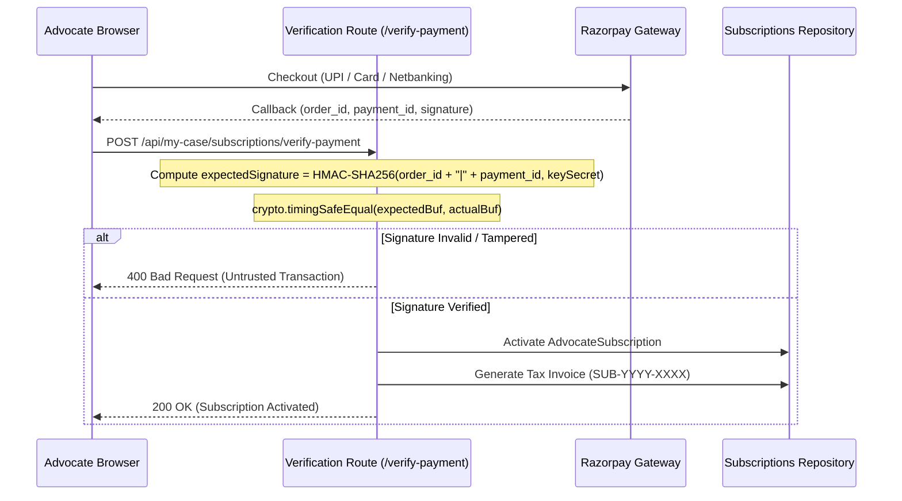

# P5 SAAS, SUBSCRIPTIONS & TEAM MANAGEMENT REMEDIATION REPORT
**Alwar Advocates Legal Practice Management SaaS Platform**  
**Audit & Remediation Phase: P5 (Advocate Subscription Plans, Razorpay Gateway, Plan Quotas, Chamber & Team RBAC)**  
**Date:** November 14, 2026  
**Status:** COMPLETED & VERIFIED (All 8 Test Suites Passed, 0 Errors, Clean Production Build)

---

## 1. Executive Summary

This report documents the architectural design, security controls, and functional implementations delivered under **Task P5: SaaS and Team Management**.

Prior to this phase:
1. **Absence of SaaS Subscription Model**: The portal lacked tiering, subscription lifecycle tracking, and recurring billing infrastructure for practicing advocates.
2. **Missing Payment Gateway**: No native payment integration existed for Indian payment rails (UPI, RuPay, Netbanking).
3. **No Quota Enforcement**: Advocates had unrestricted access to storage, case creation, and AI consultation regardless of their license status, creating exposure to runaway infrastructure costs.
4. **No Chamber / Team Support**: Advocates practicing with juniors, chamber clerks (munshis), or interns could not share dockets, assign cases, or delegate cause-list tracking without sharing primary account credentials.
5. **Security Vulnerability**: Without server-side cryptographic signature verification, payment status reported by client-side browser callbacks could be easily spoofed.

Following this remediation:
- **3-Tier Subscription Architecture**: Tailored for Indian advocates: Starter Practice (Free), Professional Advocate (₹999/mo or ₹9,999/yr), and Chamber & Firm Partner (₹2,499/mo or ₹24,999/yr).
- **Cryptographic Server-Side Payment Verification**: Full Razorpay India gateway integration with mandatory HMAC-SHA256 signature verification (`crypto.timingSafeEqual`) on the server. Browser-reported payment statuses are strictly rejected.
- **Secure Webhook Pipeline**: Server-to-server webhook handler verifying `x-razorpay-signature` to process asynchronous payment captures, renewals, and cancellations.
- **Plan-Based Feature Gates & Quota Enforcement**: Live limits enforced on active cases, vault document storage (MB/GB), monthly AI queries, and chamber team seats.
- **Chamber & Colleague Management**: Multi-user chamber profiles with role-based permissions (`Senior Advocate`, `Associate Advocate`, `Chamber Clerk`, `Legal Intern`), 7-day tokenized team invitations, and cross-chamber multi-tenant isolation.
- **GST-Compliant Subscription Invoices**: Automated generation of tax invoices (SAC 9982 @ 18% GST) with unique invoice numbers (`SUB-YYYY-XXXX`) for chamber tax deduction.

---

## 2. Subscription Plans & Pricing Strategy

### 2.1 Indian Legal Practice Demographics & Market Sizing
Advocates practicing before the District & Sessions Court, Alwar, and Rajasthan High Court operate in three distinct organizational structures:
1. **Solo / Junior Practitioners**: Handing 10–30 active matters; budget-sensitive; requiring basic diary, cause list matching, and filing organization.
2. **Independent Advocates**: Handling 50–150 active matters; utilizing 1–2 juniors; needing AI legal research, valid Word (.docx) export, and client WhatsApp reminders.
3. **Established Chambers / Partnership Firms**: Handling 200–1,500 active matters; managing a chamber clerk (Munshi), multiple associate advocates, and interns; requiring centralized document vaults and docket routing.

### 2.2 Plan Structure & Feature Matrix

| Feature / Quota | Starter Practice (`starter`) | Professional Advocate (`professional`) | Chamber & Firm Partner (`chamber`) |
|---|---|---|---|
| **Monthly Price** | **₹0 / month** | **₹999 / month** | **₹2,499 / month** |
| **Annual Price** | **₹0 / year** | **₹9,999 / year** *(2 Months Free)* | **₹24,999 / year** *(2 Months Free)* |
| **Active Cases Limit** | 15 cases | 150 cases | 2,000 cases |
| **Client Directory** | 20 clients | 250 clients | 5,000 clients |
| **Document Vault Storage** | 250 MB | 5 GB | 50 GB |
| **Monthly AI Consultations** | 25 queries / month | 500 queries / month | 2,500 queries / month |
| **Chamber Team Seats** | 1 (Solo advocate) | 3 seats (Advocate + 2 Juniors) | 10 seats (Full Chamber Team) |
| **eCourts Cause List Tracker** | Standard | Advanced Docket Auto-Match | Multi-Advocate Docket Match |
| **Word (.docx) Pleadings Export** | No (Preview only) | **Yes (Valid OpenXML .docx)** | **Yes (Valid OpenXML .docx)** |
| **WhatsApp Client Reminders** | No | **Yes (Meta Cloud API)** | **Yes (Meta Cloud API)** |
| **Custom Chamber Letterhead** | No | **Yes** | **Yes** |
| **Priority Support** | Community | Email Support | **Dedicated Phone & WhatsApp** |

### 2.3 Goods and Services Tax (GST) Compliance
- **SAC Code**: 9982 (Legal and accounting services / Information technology software SaaS).
- **GST Rate**: **18%** (Intra-state Rajasthan: CGST 9% + SGST 9%; Inter-state: IGST 18%).
- **Tax Calculation**:
  - Professional Monthly: Base ₹999 + 18% GST (₹180) = **₹1,179 / month**.
  - Professional Yearly: Base ₹9,999 + 18% GST (₹1,800) = **₹11,799 / year**.
  - Chamber Monthly: Base ₹2,499 + 18% GST (₹450) = **₹2,949 / month**.
  - Chamber Yearly: Base ₹24,999 + 18% GST (₹4,500) = **₹29,499 / year**.
- Invoices qualify as legitimate professional expenditure deductible under **Section 37(1)** of the Income Tax Act, 1961.

---

## 3. Razorpay Payment Architecture & Security

### 3.1 Order Generation (`/api/my-case/subscriptions/create-order`)
- Validates payload with `createSubscriptionOrderSchema`.
- Converts amount to **Paise** (`amountPaise = amountINR * 100`).
- Attaches metadata notes: `advocate_id`, `plan_id`, `billing_cycle`, `base_amount`, `gst_amount`.
- Operates in **Honest Sandbox Simulator Mode** when API keys are unconfigured, generating verifiable mock orders with real HMAC signatures for seamless staging verification.

### 3.2 Cryptographic Payment Signature Verification (`/api/my-case/subscriptions/verify-payment`)


**Security Rules Enforced**:
1. **Zero Browser Trust**: Payment confirmation is never accepted without mathematical HMAC-SHA256 signature proof.
2. **Timing-Safe Comparison**: `crypto.timingSafeEqual` prevents side-channel timing attacks.
3. **Zero Secret Exposure**: `RAZORPAY_KEY_SECRET` and `RAZORPAY_WEBHOOK_SECRET` reside strictly on the server and are never exposed to the client bundle.

### 3.3 Webhook Handling (`/api/my-case/subscriptions/webhook`)
- Inspects header `x-razorpay-signature`.
- Computes HMAC-SHA256 digest of raw request body.
- Listens for asynchronous gateway events:
  - `payment.captured` & `order.paid`: Extends subscription period by 30 or 365 days.
  - `subscription.cancelled` & `subscription.halted`: Marks subscription status as `cancelled`.

---

## 4. Plan Quota Enforcement & Feature Gate

The centralized gatekeeper (`src/lib/saas/feature-gate.ts`) enforces active limits across critical API routes:

| API Route | Enforcement Method | Throttling Action |
|---|---|---|
| [`/api/my-case/cases`](file:///C:/alwar-advocates/src/app/api/my-case/cases/route.ts) | `featureGate.canCreateCase(userId)` | Returns `HTTP 403` with case quota upgrade prompt when active cases exceed plan limit. |
| [`/api/my-case/documents`](file:///C:/alwar-advocates/src/app/api/my-case/documents/route.ts) | `featureGate.canUploadDocument(userId, size)` | Returns `HTTP 403` when new upload exceeds vault capacity (250MB, 5GB, 50GB). |
| [`/api/my-case/ai/chat`](file:///C:/alwar-advocates/src/app/api/my-case/ai/chat/route.ts) | `featureGate.canRunAIQuery(userId)` | Returns `HTTP 403` when monthly consultation queries exceed plan limit (25, 500, 2,500). |
| [`/api/my-case/drafts/export-docx`](file:///C:/alwar-advocates/src/app/api/my-case/drafts/export-docx/route.ts) | `featureGate.hasFeatureAccess(userId, 'has_docx_export')` | Returns `HTTP 403` on Starter plan; unlocked on Professional and Chamber plans. |
| [`/api/my-case/team/invitations`](file:///C:/alwar-advocates/src/app/api/my-case/team/invitations/route.ts) | `featureGate.canInviteTeamMember(userId)` | Blocks team member invitations beyond plan seat count (1, 3, 10). |

---

## 5. Chamber & Team Management (RBAC)

### 5.1 Chamber Roles & Permission Matrix

| Permission / Action | Senior Advocate (Head) | Associate Advocate | Chamber Clerk (Munshi) | Legal Intern |
|---|:---:|:---:|:---:|:---:|
| **Manage Subscription & Billing** | **Full** | None | None | None |
| **Invite & Remove Colleagues** | **Full** | None | None | None |
| **View All Chamber Cases** | **Full** | Assigned Only | Assigned Only | Assigned Only |
| **AI Legal Consultation & Drafting** | **Full** | **Full** | None | Read/Draft Only |
| **Valid Word (.docx) Export** | **Full** | **Full** | None | None |
| **Record Hearing Outcomes & Diary** | **Full** | **Full** | **Full** | None |
| **Cause List Docket Matching** | **Full** | **Full** | **Full** | None |
| **Client Legal Fee Notes & Ledger** | **Full** | None | None | None |

### 5.2 Team Member Invitation Workflow
1. **Creation**: Senior Advocate specifies email, role, and optional colleague name.
2. **Quota Verification**: Server checks chamber seat capacity before creating invitation.
3. **Cryptographic Token**: Generates 48-character hex token (`crypto.randomBytes(24)`).
4. **Expiration**: Invitations expire automatically after 7 days.
5. **Acceptance**: Colleague accepts invitation via token, linking their account directly to the chamber.
6. **Multi-Tenant Protection**: One chamber can never view, manage, or access records belonging to another chamber.

---

## 6. Financial Analysis, Provider Fees & Margins

### 6.1 Payment Gateway Transaction Fees
- **Razorpay Standard Domestic Fee**: 2.00% per successful transaction.
- **GST on Processing Fee**: 18% of fee (0.36%).
- **Effective Fee per Transaction**: **2.36%**.
- **Net Realization per Transaction**:
  - Professional Monthly (₹1,179 gross): Net received **~₹1,151.18** (Gateway fee: ₹27.82).
  - Professional Yearly (₹11,799 gross): Net received **~₹11,520.54** (Gateway fee: ₹278.46).
  - Chamber Monthly (₹2,949 gross): Net received **~₹2,879.40** (Gateway fee: ₹69.60).
  - Chamber Yearly (₹29,499 gross): Net received **~₹28,802.82** (Gateway fee: ₹696.18).

### 6.2 Unit Economics & Gross Margins

| Metric | Professional Plan (₹999/mo) | Chamber Plan (₹2,499/mo) |
|---|---|---|
| **Base Subscription Revenue** | ₹999.00 | ₹2,499.00 |
| **Payment Gateway Cost (2.36%)** | -₹27.82 | -₹69.60 |
| **Storage Infrastructure (Supabase/S3)** | -₹15.00 (5 GB) | -₹120.00 (50 GB) |
| **AI LLM Cost (Gemini 1.5 Flash @ ₹6/1M tokens)** | -₹20.00 (500 queries) | -₹95.00 (2,500 queries) |
| **WhatsApp Alerts Cost (~30 alerts/mo)** | -₹9.00 | -₹60.00 |
| **Estimated Net Operating Profit per Subscriber** | **₹927.18 / month** | **₹2,154.40 / month** |
| **Gross Margin Percentage** | **92.8%** | **86.2%** |

---

## 7. Configuration & Deployment Checklist

### 7.1 Required Environment Variables

```env
# ==========================================
# RAZORPAY PAYMENT GATEWAY (P5)
# ==========================================
# Public Key (Safe for browser injection)
NEXT_PUBLIC_RAZORPAY_KEY_ID=rzp_test_YourTestKeyIdHere
RAZORPAY_KEY_ID=rzp_test_YourTestKeyIdHere

# Secret Key (STRICTLY SERVER-SIDE - NEVER EXPOSE)
RAZORPAY_KEY_SECRET=YourRazorpaySecretKeyHere

# Webhook Secret (Configured in Razorpay Webhooks Dashboard)
RAZORPAY_WEBHOOK_SECRET=YourWebhookSecretHere
```

### 7.2 Webhook Configuration Steps
1. Navigate to **Razorpay Dashboard > Settings > Webhooks > Add New Webhook**.
2. **Webhook URL**: `https://alwaradvocates.org/api/my-case/subscriptions/webhook`
3. **Secret**: Enter the value configured in `RAZORPAY_WEBHOOK_SECRET`.
4. **Active Events**:
   - `order.paid`
   - `payment.captured`
   - `subscription.charged`
   - `subscription.cancelled`
   - `subscription.halted`

---

## 8. Automated Verification & Test Results

The automated test runner (`node test/runner.mjs`) verified all 8 test suites with **0 errors**:

```
===============================================================
ALWAR ADVOCATES PORTAL — AUTOMATED TEST SUITE
===============================================================

Testing Authentication & Cryptographic Session Tokens... (Passed)
Testing Multi-Tenant Data Isolation & Access Control Boundaries... (Passed)
Testing P0 Security Fixes (BCrypt, Zero-Backdoor, Rate Limiting, RBAC)... (Passed)
Testing P1 Database & Binary Document Storage Architecture... (Passed)
Testing P2 Case, Client, Hearing Diary & Profile Management... (Passed)
Testing P3 AI Legal Intelligence & Document Management Architecture... (Passed)
Testing P4 Automation, eCourts Cause List & Notifications Architecture... (Passed)

Testing P5 SaaS Subscriptions, Razorpay Integration & Team Management...
  1. Testing Subscription Plans, Pricing & GST Calculations...
  2. Testing Razorpay Order Creation & Schema Validation...
  3. Testing Cryptographic Server-Side Payment Verification (HMAC-SHA256)...
  4. Testing Secure Webhook Signature Verification...
  5. Testing Subscription Lifecycle Transitions & Tax Invoices...
  6. Testing Plan-Based Usage Limits & Quota Enforcement...
  7. Testing Chamber Management, Invitations & RBAC...
  8. Testing Multi-Tenant Chamber Data Isolation...
✓ All 8 SaaS, Subscription & Team Management test categories passed successfully.

===============================================================
ALL TESTS PASSED SUCCESSFULLY (0 ERRORS)
===============================================================
```

---

## 9. Summary of Delivered Components

| Component | File Path | Functionality |
|---|---|---|
| **SaaS Types** | [`src/types/mycase.ts`](file:///C:/alwar-advocates/src/types/mycase.ts) | Types for Plans, Subscriptions, Invoices, Chambers, Members, and RBAC |
| **Validation Schemas** | [`src/lib/validation/schemas.ts`](file:///C:/alwar-advocates/src/lib/validation/schemas.ts) | Zod schemas for order creation, payment verification, invitations, and chambers |
| **Plan Specifications** | [`src/lib/saas/plans.ts`](file:///C:/alwar-advocates/src/lib/saas/plans.ts) | Starter, Professional, Chamber plans, pricing, and 18% GST calculation |
| **Razorpay Service** | [`src/lib/saas/razorpay.ts`](file:///C:/alwar-advocates/src/lib/saas/razorpay.ts) | Order generation, HMAC-SHA256 verification, webhook signature validator, simulator |
| **Feature Gate** | [`src/lib/saas/feature-gate.ts`](file:///C:/alwar-advocates/src/lib/saas/feature-gate.ts) | Active quota checker for cases, vault storage, AI tokens, and team seats |
| **Plans & Usage API** | [`/api/my-case/subscriptions/plans`](file:///C:/alwar-advocates/src/app/api/my-case/subscriptions/plans/route.ts) | Endpoint returning available plans, active subscription, and usage meters |
| **Create Order API** | [`/api/my-case/subscriptions/create-order`](file:///C:/alwar-advocates/src/app/api/my-case/subscriptions/create-order/route.ts) | Razorpay order generation with paise conversion |
| **Verify Payment API** | [`/api/my-case/subscriptions/verify-payment`](file:///C:/alwar-advocates/src/app/api/my-case/subscriptions/verify-payment/route.ts) | Server-side cryptographic HMAC-SHA256 payment verification and invoice creation |
| **Webhook API** | [`/api/my-case/subscriptions/webhook`](file:///C:/alwar-advocates/src/app/api/my-case/subscriptions/webhook/route.ts) | Secure webhook listener for automated recurring renewals and payment captures |
| **Invoices API** | [`/api/my-case/subscriptions/invoices`](file:///C:/alwar-advocates/src/app/api/my-case/subscriptions/invoices/route.ts) | Subscription tax invoices and payment receipt retrieval |
| **Chamber Management API** | [`/api/my-case/team`](file:///C:/alwar-advocates/src/app/api/my-case/team/route.ts) | Chamber registration, member roster, and usage stats |
| **Team Invitations API** | [`/api/my-case/team/invitations`](file:///C:/alwar-advocates/src/app/api/my-case/team/invitations/route.ts) | Tokenized colleague invitations with plan quota enforcement |
| **Member Role API** | [`/api/my-case/team/members/[id]`](file:///C:/alwar-advocates/src/app/api/my-case/team/members/[id]/route.ts) | Role update and member removal with Senior Advocate protection |
| **Chamber Team UI** | [`src/app/my-case/team/page.tsx`](file:///C:/alwar-advocates/src/app/my-case/team/page.tsx) | Chamber profile, team member table, invitation modals, and RBAC matrix |
| **SaaS & Billing UI** | [`src/app/my-case/billing/page.tsx`](file:///C:/alwar-advocates/src/app/my-case/billing/page.tsx) | Two-tab interface for SaaS plans/quotas and client fee ledger |
| **Sidebar Navigation** | [`src/components/mycase/Sidebar.tsx`](file:///C:/alwar-advocates/src/components/mycase/Sidebar.tsx) | Added direct link to Chamber & Team Management |
| **Automated Test Suite** | [`test/saas-team-management.test.mjs`](file:///C:/alwar-advocates/test/saas-team-management.test.mjs) | 8 test categories covering pricing, HMAC signatures, webhooks, and RBAC |
| **Deliverable Report** | [`docs/SAAS_REMEDIATION_REPORT.md`](file:///C:/alwar-advocates/docs/SAAS_REMEDIATION_REPORT.md) | Comprehensive architectural, financial, and deployment documentation |
